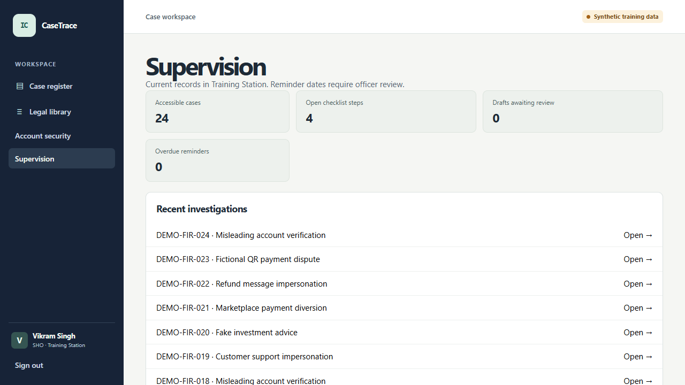

<div align="center">

# CaseTrace

**Follow the evidence, trace the transfers and review every next step.**

A self-hosted financial-fraud investigation workspace with separate training and operational configurations. Officers can preserve evidence, search cited legal references and original statutory pages, trace transfers, track reviewed dates, and approve notice drafts. Supervisors can assign officers, review activity and inspect possible links across authorized cases.

**1.0 release candidate:** the operational configuration is tested locally with synthetic data. Agency approval, hosting, identity integration, retention policy and external-system access are still required before a real-case rollout. [Deployment and acceptance guide](docs/production.md).


[Quick start](#quick-start) · [Testing](#testing) · [Scope](#scope)

</div>

---



## The problem

A financial-fraud case brings together documents, transaction records, legal references and follow-up dates. CaseTrace organises those records around a synthetic case so an officer can review evidence and prepare the next steps in one workspace.

## At a glance

| Area | What it covers |
| --- | --- |
| Evidence | Original files, hashes, extracted text and entities |
| Investigation | Cited checklists, legal lookup and deadline reminders |
| Review | Money trails, notice approval and case activity records |

## Quick start

Use Docker Compose 2.24.4 or later. Ports 5173 and 8000 are bound to loopback. This quick start launches the synthetic training configuration.

```powershell
Copy-Item .env.example .env
```

Edit `.env` and set an independent random `JWT_SECRET` of at least 32 characters. The database URL in Compose expects a URL-safe database password. Then run:

```powershell
docker compose up -d --build
docker compose exec -T api python -m app.seed
```

Open [the case workspace](http://localhost:5173) and sign in with `demo.io` and the `DEMO_PASSWORD` from `.env`. Use `demo.sho` to review a notice. The seed also creates `demo.co`, `demo.sp` and a second-station `demo.other` account. Seeds create missing records and preserve existing accounts and passwords.

The API provides [OpenAPI documentation](http://localhost:8000/docs). [Health](http://localhost:8000/health) checks database connectivity.

## Run locally on Windows

Use Python 3.12 and Node.js 22.12 or later. For scanned evidence, install Tesseract with the `eng` and `hin` languages and Poppler with `pdftoppm`. The default local database is SQLite. Compose uses PostgreSQL and pgvector.

```powershell
cd backend
py -3.12 -m venv .venv
$py = ".\.venv\Scripts\python.exe"
& $py -m pip install -r requirements.lock
& $py -m pip install -e ".[dev]"
$env:JWT_SECRET = (& $py -c "import secrets; print(secrets.token_urlsafe(48))")
$env:DEMO_PASSWORD = "demo-only-change-me"
& $py -m alembic upgrade head
& $py -m app.seed
& $py -m uvicorn app.main:app --port 8000
```

From the project root in another terminal:

```powershell
cd frontend
npm ci
npm run dev
```

## Try the workflow

1. Sign in as `demo.io` and open `DEMO-FIR-001`. Review its original and extracted entities, or upload another synthetic file from `data/synthetic`.
2. Generate the investigation plan. Open a citation, complete a step, and calculate reminders from the case dates.
3. Open **Money trail** to see the seeded bank transfers and ranked terminal balances.
4. Draft a bank statement notice. Sign in as `demo.sho`, approve the draft, record the simulated send, and open **Activity** to review the resulting events.
5. Ask the legal library about a victim progress update. Compare the linked official source with the section summary.

[Architecture and design decisions](docs/architecture.md) · [Demo walkthrough](docs/demo-walkthrough.md)

[Recorded synthetic workflow](docs/demo.webm) · [Verification evidence](docs/verification.md) · [Automated browser checks](docs/testing.md)

## Operational deployment

The separate `compose.production.yml` configuration uses HTTPS, an empty case database, individually provisioned officers, a restricted PostgreSQL application role and revocable sessions. Production seeding is blocked. Notice delivery is recorded manually with an external reference and uploaded proof; CaseTrace does not send notices to third parties. Progress reminders require an officer-confirmed anchor date.

Follow [the production runbook](docs/production.md) to configure the domain, independent secrets, administrator, encrypted backups, monitoring and acceptance checks. Keep test and real-case installations separate.

## Original statutory text

From the backend environment, run `python -m app.ingest_statutes` to download the four configured official PDFs and index every text page. The importer records the URL, retrieval date and SHA-256, keeps an offline source manifest, and replaces an act only after its PDF has been parsed successfully. The verified source set contains 441 pages across BNSS, BNS, BSA and the IT Act.

The legal library distinguishes curated summaries from original-text search results. Corpus snapshots do not establish that a provision is currently applicable; the responsible reviewer must check commencement, amendments, local rules and the case dates.

## Local model

The baseline uses deterministic extraction, matching and templates. To enable local suggestions and vector search in Compose, set `OLLAMA_MODEL=qwen2.5:3b` and `EMBEDDING_MODEL=nomic-embed-text` in `.env`. Start the profile, install the models and reindex. Model downloads require internet access. Inference runs inside the local installation.

```powershell
docker compose --profile model up -d --build
docker compose --profile model exec -T ollama ollama pull qwen2.5:3b
docker compose --profile model exec -T ollama ollama pull nomic-embed-text
docker compose exec -T api python /project/scripts/ingest_law.py
```

## Testing

```powershell
# From backend with the virtual environment available
& .\.venv\Scripts\python.exe -m pytest -q
& .\.venv\Scripts\ruff.exe check .
# From frontend
npm run lint
npm run build
```

The backend suite checks access isolation, evidence integrity, approval transitions, transaction import idempotence, deadline calculations, and citation accuracy on a 20-question golden set. GitHub Actions checks the PostgreSQL migration and runs the test and build jobs.

The expanded suite runs the application workflows against both migrated SQLite and PostgreSQL schemas. CI also checks real Hindi scanned-image/PDF OCR, backend/frontend dependency advisories, browser workflows and the mobile layout. See [testing](docs/testing.md) for exact commands and runtime probes. Backend runtime versions are pinned in `backend/requirements.lock`.

## Scope

Training mode is for synthetic data and simulated dispatch. Operational mode supports recorded case workflows and manual external-dispatch evidence; its availability is not agency authorization. Officers review all suggestions and retain authority over investigative decisions. The curated English section summaries, full-text document snapshots and inferred money-trail priorities are review aids.

Related-case matching is restricted to cases the current officer may access. A matching identifier does not establish a relationship between suspects or prove an offence. Bank, telecom and CCTNS integrations are not present; they require approved access and a separately reviewed integration contract. No such credentials or deployment authority have been supplied.
