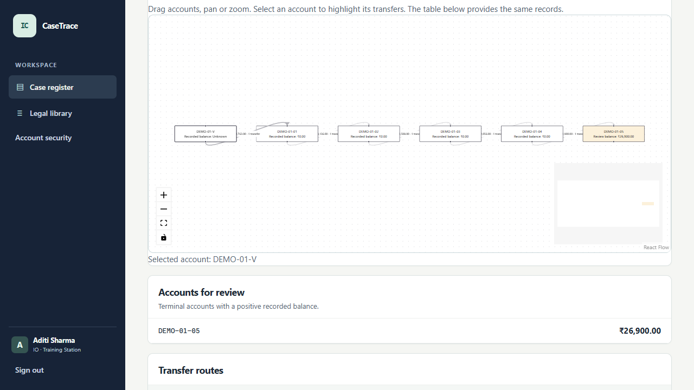

<div align="center">

# CaseTrace

**Follow the evidence, trace the transfers and review every next step.**

A self-hosted training workspace for an online financial fraud investigation. Officers can review synthetic evidence, query a section-level legal library, track a checklist and deadlines, trace transfers, and record supervisory approval of a draft notice.


[Quick start](#quick-start) · [Testing](#testing) · [Scope](#scope)

</div>

---



## The problem

A financial-fraud case brings together documents, transaction records, legal references and follow-up dates. CaseTrace organises those records around a synthetic case so an officer can review evidence and prepare the next steps in one workspace.

## At a glance

| Area | What it covers |
| --- | --- |
| Evidence | Original files, hashes, extracted text and entities |
| Investigation | Cited checklists, legal lookup and deadline reminders |
| Review | Money trails, notice approval and case activity records |

## Quick start

Use Docker Compose v2. Ports 5173 and 8000 are bound to loopback.

```powershell
Copy-Item .env.example .env
```

Edit `.env` and set an independent random `JWT_SECRET` of at least 32 characters. The database URL in Compose expects a URL-safe database password. Then run:

```powershell
docker compose up -d --build
docker compose exec -T api python -m app.seed
```

Open [the case workspace](http://localhost:5173) and sign in with `demo.io` and the `DEMO_PASSWORD` from `.env`. Use `demo.sho` to review a notice. The seed also creates `demo.co`, `demo.sp` and a second-station `demo.other` account. Seeds create missing records and preserve existing accounts and passwords.

The API provides [OpenAPI documentation](http://localhost:8000/docs). [Health](http://localhost:8000/health) checks database connectivity.

## Run locally on Windows

Use Python 3.12 and Node.js 22.12 or later. For scanned evidence, install Tesseract with the `eng` and `hin` languages and Poppler with `pdftoppm`. The default local database is SQLite. Compose uses PostgreSQL and pgvector.

```powershell
cd backend
py -3.12 -m venv .venv
$py = ".\.venv\Scripts\python.exe"
& $py -m pip install -e ".[dev]"
$env:JWT_SECRET = (& $py -c "import secrets; print(secrets.token_urlsafe(48))")
$env:DEMO_PASSWORD = "demo-only-change-me"
& $py -m alembic upgrade head
& $py -m app.seed
& $py -m uvicorn app.main:app --port 8000
```

From the project root in another terminal:

```powershell
cd frontend
npm ci
npm run dev
```

## Try the workflow

1. Sign in as `demo.io` and open `DEMO-FIR-001`. Review its original and extracted entities, or upload another synthetic file from `data/synthetic`.
2. Generate the investigation plan. Open a citation, complete a step, and calculate reminders from the case dates.
3. Open **Money trail** to see the seeded bank transfers and ranked terminal balances.
4. Draft a bank statement notice. Sign in as `demo.sho`, approve the draft, record the simulated send, and open **Activity** to review the resulting events.
5. Ask the legal library about a victim progress update. Compare the linked official source with the section summary.

[Architecture and design decisions](docs/architecture.md) · [Demo walkthrough](docs/demo-walkthrough.md)

## Local model

The baseline uses deterministic extraction, matching and templates. To enable local suggestions and vector search in Compose, set `OLLAMA_MODEL=qwen2.5:3b` and `EMBEDDING_MODEL=nomic-embed-text` in `.env`. Start the profile, install the models and reindex. Model downloads require internet access. Inference runs inside the local installation.

```powershell
docker compose --profile model up -d --build
docker compose --profile model exec -T ollama ollama pull qwen2.5:3b
docker compose --profile model exec -T ollama ollama pull nomic-embed-text
docker compose exec -T api python /project/scripts/ingest_law.py
```

## Testing

```powershell
# From backend with the virtual environment available
& .\.venv\Scripts\python.exe -m pytest -q
& .\.venv\Scripts\ruff.exe check .
# From frontend
npm run lint
npm run build
```

The backend suite checks access isolation, evidence integrity, approval transitions, transaction import idempotence, deadline calculations, and citation accuracy on a 20-question golden set. GitHub Actions checks the PostgreSQL migration and runs the test and build jobs.

## Scope

Use synthetic data only. Notice delivery is simulated. Officers review all suggestions and retain authority over investigative decisions. The curated legal corpus covers a small set of English-language section summaries. For operational context, open the linked official text and verify applicable rules, notifications, amendments and dates.

Future work includes cross-case linking, a supervisor dashboard and an authorized CCTNS integration.
