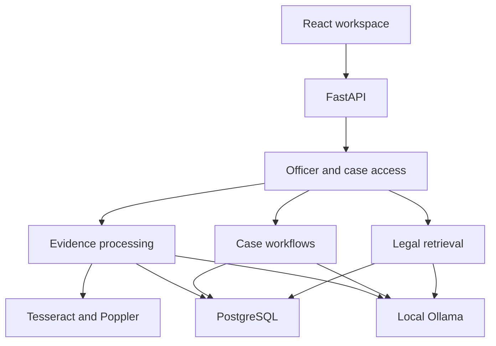

# Architecture

The browser uses one same-origin API behind the Vite proxy or the Compose reverse proxy. The data layer uses SQLAlchemy and Alembic. PostgreSQL and pgvector are available in Compose, with SQLite for local training.

## Data and access

| Record | Behavior |
| --- | --- |
| Case | An IO sees assigned cases in their station. SHO, CO and SP roles review cases in their station and can reassign them to an active IO. |
| Evidence | Original bytes and SHA-256 are stored together. The same digest can appear once per case. Downloads are served as attachments. |
| Audit event | Successful domain events commit with the write. Other API write requests record the route and result. Request bodies and credentials stay out of the log. |
| Notice | An authorized officer drafts the record. A separate supervisor approves it. Training allows a simulated send. Production requires an external dispatch reference and an original proof file from the same case. |
| Transfer | Import validates all rows before saving them. An identical reference can be re-imported. A conflicting reference rejects the batch. |
| Deadline | Victim progress, custody review and officer-set report targets are shown individually with their calculation basis. |

## Case-type plug-ins

The `financial_fraud` folder contains its checklist, reminder configuration and notice templates. The application ships this single case type. Supporting a new case type requires adding its resources and exposing it through case creation.

## Evidence and law

PDF processing extracts native text and uses Tesseract for image-only pages. Image processing normalizes orientation before OCR. Uploads are limited to 8 MiB, eight PDF pages and bounded OCR time. In environments without OCR tools, original evidence can still be stored with its extraction state.

The legal library separates curated section summaries from original statutory pages. The original-PDF importer records source URLs, page numbers, retrieval dates and complete-file hashes, parsing a replacement before changing its database index. Original-text retrieval is a page search rather than an assertion of legal applicability. PostgreSQL can rank the curated section embeddings using pgvector. AI may suggest a neutral rewrite of draft facts or confirm exact digits found in ambiguous account formatting. Regular expressions handle clear, labeled evidence patterns and OCR spacing without inventing digits.

NetworkX builds the directed account graph. Its review list consists of terminal accounts with a positive recorded balance, ranked by that balance. React Flow provides pan, zoom, draggable visual positions and account selection; moving a node changes only the display. This is a triage view of supplied data. Related-case matches compare phone, account and UPI identifiers only within the current officer's case access boundary.

## Configurations and operator boundaries

Training seeds a 24-case fictional dataset and role-scoped examples on loopback ports. Production has a separate Compose project, HTTPS gateway, migration-owner connection and restricted application account. Startup rejects known seeded demo users/cases, and production seeding is disabled. Password changes, account deactivation and role updates invalidate old sessions; logout revokes the current session. Sign-in limits are persisted across workers and restarts (10 attempts per normalized username and 200 per transport peer within a 15-minute bucket).

Database triggers prevent updates/deletes of originals and audit events, and the production runtime role lacks those permissions. Downloads verify stored SHA-256 and record access. Host/database superusers remain trusted operators. Encrypted backups use AES-GCM and isolated restore verification; no automatic retention purge is enabled.

The application does not integrate with bank, telecom or CCTNS services, establish an officer's real-world authority or supply an agency retention policy. Institutional identity/MFA, data handling rules, hosting, legal review and agency acceptance remain installation requirements. See [the production runbook](production.md).
