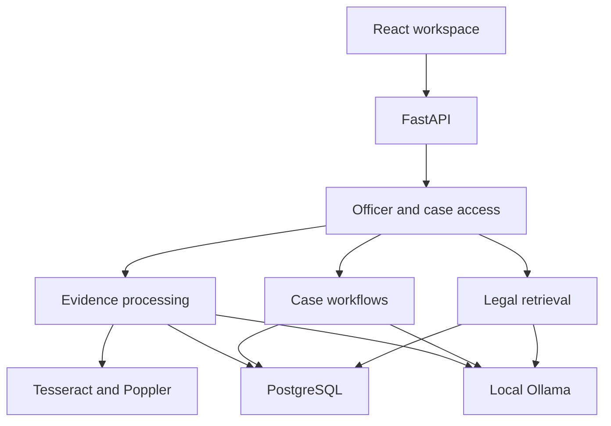

# Architecture

The browser uses one same-origin API behind the Vite proxy or the Compose reverse proxy. The data layer uses SQLAlchemy and Alembic. PostgreSQL and pgvector are available in Compose, with SQLite for local training.

## Data and access

| Record | Behavior |
| --- | --- |
| Case | An IO sees assigned cases in their station. SHO, CO and SP demo accounts see cases in their own station. |
| Evidence | Original bytes and SHA-256 are stored together. The same digest can appear once per case. Downloads are served as attachments. |
| Audit event | Successful domain events commit with the write. Other API write requests record the route and result. Request bodies and credentials stay out of the log. |
| Notice | An authorized officer drafts the record. A separate supervisor approves it. Approved records can be marked sent in the simulation. |
| Transfer | Import validates all rows before saving them. An identical reference can be re-imported. A conflicting reference rejects the batch. |
| Deadline | Victim progress, custody review and officer-set report targets are shown individually with their calculation basis. |

## Case-type plug-ins

The `financial_fraud` folder contains its checklist, reminder configuration and notice templates. The application ships this single case type. Supporting a new case type requires adding its resources and exposing it through case creation.

## Evidence and law

PDF processing extracts native text and uses Tesseract for image-only pages. Image processing normalizes orientation before OCR. Uploads are limited to 8 MiB, eight PDF pages and bounded OCR time. In environments without OCR tools, original evidence can still be stored with its extraction state.

The legal corpus stores verified section identifiers, paraphrased summaries and links to the official documents. PostgreSQL can rank stored section embeddings using pgvector. The API returns a stored summary and citation, or abstains if retrieval is weak. AI may suggest a neutral rewrite of draft facts or help confirm ambiguous account formatting. Regular expressions handle clear evidence patterns.

NetworkX builds the directed account graph. Its review list consists of terminal accounts with a positive recorded balance, ranked by that balance. This is a triage view of supplied data.

## Demo boundaries

The seed creates a 24-case fictional dataset and role-scoped access examples. The workspace is for a loopback training environment. External delivery, production identity integration, real-case retention controls and agency-specific legal review are outside the demo.
